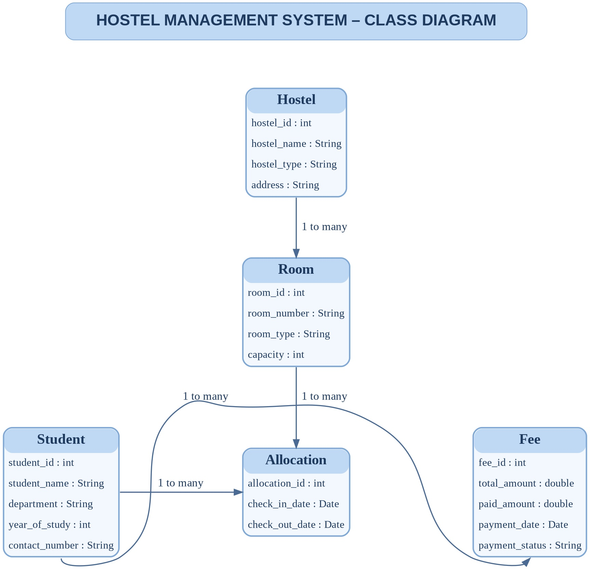

# CLASS DIAGRAM

The following diagram represents the classes and relationships in the Hostel Management System.

# ENTITY RELATIONSHIP DIAGRAM

The following ER diagram represents the entities, attributes, primary keys, foreign keys, and relationships in the Hostel Management System.

```mermaid
erDiagram
    HOSTELS ||--o{ ROOMS : has
    STUDENTS ||--o{ ALLOCATIONS : receives
    ROOMS ||--o{ ALLOCATIONS : assigned
    STUDENTS ||--o{ FEES : pays

    HOSTELS {
        int hostel_id PK
        string hostel_name
        string hostel_type
        string address
    }

    STUDENTS {
        int student_id PK
        string student_name
        string department
        int year_of_study
        string contact_number
    }

    ROOMS {
        int room_id PK
        int hostel_id FK
        string room_number
        string room_type
        int capacity
    }

    ALLOCATIONS {
        int allocation_id PK
        int student_id FK
        int room_id FK
        date check_in_date
        date check_out_date
    }

    FEES {
        int fee_id PK
        int student_id FK
        decimal total_amount
        decimal paid_amount
        date payment_date
        string payment_status
    }
```

The Entity Relationship (ER) Diagram illustrates the structure of the Hostel Management System database. It represents five main entities: Hostel, Room, Student, Allocation, and Fee.

Each entity contains attributes, including primary keys (PK) and foreign keys (FK). The relationships show how hostels contain rooms, students receive room allocations, and students make fee payments.

This diagram helps understand the database structure and the relationships between different tables.
.png)